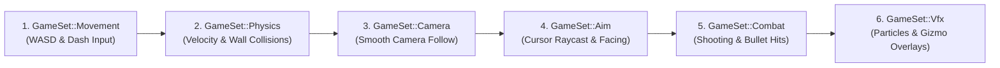

<div align="center">

# ⚙️ oxide-core

**A fast-paced low-poly top-down 3D action prototype, written in Rust with Bevy 0.15.**

*Snappy movement inspired by the momentum of ULTRAKILL, wrapped in a retro low-poly aesthetic.*

[](README_RU.md)


</div>

---

> 📖 **Language versions:**
> - [English version (this file)](README.md)
> - [Русская версия](README_RU.md)

---

## ✨ Features

- **Responsive Movement**: Instant acceleration (`120.0`) and high friction (`160.0`). Zero ice-skating effect.
- **Dash Mechanic (Space)**: Quick directional burst (`42.0` speed, `0.14s` duration, `0.5s` cooldown) leaving afterimage trail ghosts and particle sparks.
- **Cursor Raycast Aiming**: Projects a 3D ray through the camera onto the horizontal shooting plane (`Camera::viewport_to_world`), turning the player toward the cursor.
- **Dynamic Combat**: Fast glowing projectiles with lifespan despawn, muzzle flashes, and collision spark bursts.
- **Procedural VFX & Visual Guides**: HDR + Bloom glow, laser targeting ray, ground crosshair, and a dash cooldown indicator ring beneath the player's feet.
- **Smooth Follow Camera**: Frame-rate independent exponential LERP camera follow with isometric-like perspective (~56° tilt).
- **Minimal Dependencies**: Pure `bevy` 0.15. No external physics or heavy math crates required.

---

## 🎮 Controls

| Input | Action |
|-------|--------|
| `W` `A` `S` `D` | Movement (relative to world axes) |
| `Space` | Dash in direction of movement (or facing direction if stationary) |
| `Mouse` | Aiming (raycast to ground plane) |
| `Left Mouse Button` | Fire projectile (hold for automatic fire) |

---

## 🚀 Build & Run

**Prerequisites:** [Rust](https://rustup.rs/) (stable, 2024 edition) and a Vulkan / DirectX 12 / Metal compatible GPU.  
*(On Linux, install [Bevy's system dependencies](https://github.com/bevyengine/bevy/blob/main/docs/linux_dependencies.md)).*

```bash
git clone https://github.com/augustuz/oxide-core.git
cd oxide-core
cargo run
```

> [!TIP]
> The initial build compiles Bevy and its dependencies (optimized via dev profile settings in `Cargo.toml`).
> For maximum framerate and smoothness, run a release build:
> ```bash
> cargo run --release
> ```

---

## 🧭 Architecture & How to Modify

The project follows a clean, modular ECS plugin architecture. Every core subsystem lives in its own dedicated module under `src/` as a self-contained Bevy `Plugin`.

### 🗂️ Module Directory

| Module | File | Role & Key Responsibilities | Key Types & Resources |
|--------|------|-----------------------------|-----------------------|
| **Core** | [`src/main.rs`](src/main.rs) | Window configuration, Bevy plugins registration, and frame phase ordering. | `enum GameSet`, `fn main` |
| **Config** | [`src/config.rs`](src/config.rs) | Single source of truth for all tuning constants (speeds, cooldowns, camera offset, colors). | `MOVE_SPEED`, `DASH_SPEED`, `CAMERA_OFFSET`, etc. |
| **Arena** | [`src/arena.rs`](src/arena.rs) | Level generation: ground plane, perimeter walls, obstacles, and directional sun light. | `ArenaPlugin`, `Obstacle`, `OBSTACLES` |
| **Physics** | [`src/physics.rs`](src/physics.rs) | Custom velocity integration and circle-vs-AABB obstacle collision & sliding. | `PhysicsPlugin`, `Velocity`, `move_towards` |
| **Player** | [`src/player.rs`](src/player.rs) | Player spawning, WASD input handling, dash logic, and cooldown ring gizmo. | `PlayerPlugin`, `Player`, `PlayerAssets` |
| **Camera** | [`src/camera.rs`](src/camera.rs) | Camera entity spawn (HDR + Bloom + Tonemapping) and smooth player follow. | `CameraPlugin`, `MainCamera` |
| **Aim** | [`src/aim.rs`](src/aim.rs) | Raycasting cursor onto horizontal plane, player Y-rotation, laser and crosshair gizmos. | `AimPlugin`, `AimPoint` |
| **Combat** | [`src/combat.rs`](src/combat.rs) | Projectile spawning, movement, lifetime expiration, and obstacle impact handling. | `CombatPlugin`, `Projectile`, `CombatAssets` |
| **VFX** | [`src/vfx.rs`](src/vfx.rs) | Procedural particle simulation (sparks, dash ghosts) with fast deterministic pseudo-random hashing. | `VfxPlugin`, `VfxAssets`, `spawn_sparks`, `hash01` |
| **UI** | [`src/ui.rs`](src/ui.rs) | Top-left HUD controls reminder text. | `UiPlugin` |

---

### ⏱️ Frame Execution Order (`GameSet`)

All systems in the game run in a deterministic, chained order defined in [`src/main.rs`](src/main.rs):



> [!NOTE]
> When adding a new system, register it within the appropriate set using `.in_set(GameSet::<Set>)`.  
> This prevents 1-frame lagging, input jitters, or visual desynchronization.

---

### 💡 Quick Modification Guide ("I want to...")

- **Adjust movement or combat balance:**  
  Open [`src/config.rs`](src/config.rs) and modify speeds, accelerations, or cooldown values.
- **Add, remove, or rearrange obstacles:**  
  Open [`src/arena.rs`](src/arena.rs) and edit the `OBSTACLES` slice at the top of the file.
- **Change player visuals or colors:**  
  Adjust dimensions/colors in [`src/config.rs`](src/config.rs) (`PLAYER_SIZE`, `COLOR_PLAYER`) or modify materials in [`src/player.rs`](src/player.rs).
- **Modify projectile visuals or speed:**  
  Open [`src/combat.rs`](src/combat.rs) (`CombatAssets`) or [`src/config.rs`](src/config.rs) (`PROJECTILE_SPEED`, `PROJECTILE_RADIUS`).
- **Add a new game feature (e.g., enemies, score, sounds):**  
  1. Create a new module file, e.g. `src/enemy.rs`.
  2. Define an `EnemyPlugin` implementing `bevy::app::Plugin`.
  3. Register your systems into `GameSet::Combat` or another relevant phase.
  4. Declare `pub mod enemy;` and add `enemy::EnemyPlugin` into `add_plugins(...)` in [`src/main.rs`](src/main.rs).

---

### 🩺 Troubleshooting & Diagnostics

| Symptom | Probable Cause | Where to Check |
|---------|----------------|----------------|
| **Jittering laser / aiming lags behind player** | Camera or player transform updated after raycasting | Check `GameSet::Aim` is ordered *after* `GameSet::Movement` and `GameSet::Camera` in [`src/main.rs`](src/main.rs) |
| **Player passes through walls or gets stuck** | High velocity step exceeds collision thickness, or missing `Obstacle` component | Check `resolve_player_collisions` in [`src/physics.rs`](src/physics.rs) and obstacle dimensions in [`src/arena.rs`](src/arena.rs) |
| **Bullets pass through obstacles without hitting** | Projectile speed is too high for frame `dt` | Increase obstacle bounding thickness or implement continuous swept raycast in [`src/combat.rs`](src/combat.rs) |
| **Aim line does not align with cursor point** | Raycast plane height mismatch | Verify `AIM_PLANE_Y` in [`src/config.rs`](src/config.rs) matches the player muzzle/nose world height |

---

## 🧪 Quality Assurance & Logging (`check_and_log.bat`)

A comprehensive diagnostic script for Windows is provided in the repository root:

```bat
check_and_log.bat        :: Runs fmt check, compilation check, and pedantic Clippy analysis
check_and_log.bat run    :: Runs checks, then launches the game and captures runtime stdout/stderr
```

The script automatically generates a local `logs/` directory containing complete build and linter reports:
- `logs/fmt_check.log`
- `logs/cargo_check.log`
- `logs/clippy_analysis.log`
- `logs/runtime.log` *(when executed with `run`)*

The script outputs a summary table directly to the console and exits with code `1` if any step fails (fully compatible with CI).

---

## 📜 License

Distributed under the [MIT License](LICENSE). © 2026 augustuz.
