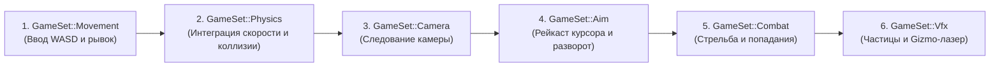

<div align="center">

# ⚙️ oxide-core

**Динамичный 3D top-down экшен-прототип в низкополигональном ретро-стиле на Rust и Bevy 0.15.**

*Резкая физика движения в духе ULTRAKILL, процедурные визуальные эффекты и модульная архитектура Bevy ECS.*

[](README.md)


</div>

---

> 📖 **Языковые версии:**
> - [Русская версия (этот файл)](README_RU.md)
> - [English version](README.md)

---

## ✨ Особенности прототипа

- **Отзывчивое управление**: Быстрый разгон (`120.0`) и мгновенное торможение (`160.0`). Никакого эффекта «скольжения по льду».
- **Механика рывка (Space)**: Резкий импульс со скоростью `42.0` (длительность `0.14с`, кулдаун `0.5с`), полупрозрачный след из призраков игрока и веер искр.
- **Прицеливание через Raycast мыши**: Проекция 3D-луча из камеры через курсор на горизонтальную плоскость высоты ствола (`Camera::viewport_to_world`), точный разворот игрока в сторону курсора.
- **Стрельба и попадания**: Быстрые светящиеся снаряды с авто-деспавном по таймеру, дульные вспышки и взрывы искр при попадании в препятствия.
- **Процедурные эффекты и визуальные подсказки**: HDR + Bloom свечение, лазерный луч прицела, наэкранное перекрестие на земле и индикатор готовности рывка под ногами.
- **Сглаженная камера**: Экспоненциальный LERP следования камеры за игроком, не зависящий от FPS, под изометрическим углом (~56° наклона).
- **Минимум зависимостей**: Только чистый `bevy` 0.15. Вся физика, коллизии и частицы написаны на чистом Rust без тяжёлых сторонних движков.

---

## 🎮 Управление

| Клавиша / Кнопка | Действие |
|------------------|----------|
| `W` `A` `S` `D` | Перемещение по плоскости арены |
| `Space` (Пробел) | Рывок в сторону движения (или взгляда, если игрок стоит) |
| `Мышь` | Прицеливание (рейкаст луча на плоскость) |
| `ЛКМ` | Выстрел (можно зажимать для непрерывной стрельбы) |
| `R` | Перезапуск симуляции (на экране Game Over) |

---

## 🚀 Сборка и запуск

**Требования:** [Rust](https://rustup.rs/) (версия с поддержкой редакции 2024) и видеокарта с поддержкой Vulkan / DirectX 12 / Metal.  
*(На Linux убедитесь, что установлены [системные зависимости Bevy](https://github.com/bevyengine/bevy/blob/main/docs/linux_dependencies.md)).*

```bash
git clone https://github.com/augustuz/oxide-core.git
cd oxide-core
cargo run
```

> [!TIP]
> При первой сборке компилируется движок Bevy (в профиле `dev` в `Cargo.toml` уже включена оптимизация зависимостей).
> Для наивысшей частоты кадров запускайте в release-режиме:
> ```bash
> cargo run --release
> ```

---

## 🧭 Архитектура и руководство по модификации

Кодовая база разбита на независимые и понятные модули в папке `src/`. Каждый модуль инкапсулирует свою предметную область в виде Bevy `Plugin`.

### 🗂️ Карта модулей

| Модуль | Файл | Назначение и ответственность | Ключевые типы и ресурсы |
|--------|------|------------------------------|-------------------------|
| **Core** | [`src/main.rs`](src/main.rs) | Точка входа: инициализация окна, регистрация плагинов и строгая настройка фаз кадра. | `enum GameSet`, `fn main` |
| **Config** | [`src/config.rs`](src/config.rs) | Единый источник всех констант баланса: скорости, тайминги, смещение камеры, цвета палитры. | `MOVE_SPEED`, `DASH_SPEED`, `CAMERA_OFFSET` и др. |
| **Arena** | [`src/arena.rs`](src/arena.rs) | Генерация уровня: пол арены 100x100, стены, расстановка препятствий и свет. | `ArenaPlugin`, `Obstacle`, `OBSTACLES` |
| **Physics** | [`src/physics.rs`](src/physics.rs) | Физика перемещения: компонент скорости `Velocity` и расчет скольжения круг-vs-AABB. | `PhysicsPlugin`, `Velocity`, `move_towards` |
| **Player** | [`src/player.rs`](src/player.rs) | Логика игрока: WASD-управление, рывок (Dash) и круг готовности под ногами. | `PlayerPlugin`, `Player`, `PlayerAssets` |
| **Camera** | [`src/camera.rs`](src/camera.rs) | Спавн камеры (HDR + Bloom + Tonemapping) и независимое от FPS сглаженное следование. | `CameraPlugin`, `MainCamera` |
| **Aim** | [`src/aim.rs`](src/aim.rs) | Прицеливание: рейкаст курсора в 3D-мир, поворот игрока по оси Y, лазер и перекрестие. | `AimPlugin`, `AimPoint` |
| **Combat** | [`src/combat.rs`](src/combat.rs) | Стрельба: спавн снарядов, их полет, деспавн по таймеру и попадания по врагам/стенам. | `CombatPlugin`, `Projectile`, `CombatAssets` |
| **Enemy** | [`src/enemy.rs`](src/enemy.rs) | Враги с ИИ преследования игрока, компонент `Health`, периодический спавнер и счетчик волны. | `EnemyPlugin`, `Enemy`, `Health`, `WaveStats` |
| **VFX** | [`src/vfx.rs`](src/vfx.rs) | Система процедурных частиц: искры, след рывка и разлёт воксельных осколков врага. | `VfxPlugin`, `VfxAssets`, `spawn_sparks`, `spawn_death_chunks` |
| **UI** | [`src/ui.rs`](src/ui.rs) | Текстовая подсказка управления и динамический счётчик уничтоженных/активных врагов. | `UiPlugin` |

---

### ⏱️ Порядок фаз кадра (`GameSet`)

Все системы игры выполняются в строго определенном порядке, заданном в [`src/main.rs`](src/main.rs):



> [!NOTE]
> Добавляя новую систему в проект, обязательно указывайте фазу через `.in_set(GameSet::<НужныйСет>)`.  
> Это предотвращает задержки в 1 кадр, дрожание камеры или отставание лазера от носа игрока.

---

### 💡 Шпаргалка («Я хочу изменить...»)

- **Подкрутить скорость движения, силу рывка или дальность камеры:**  
  Откройте [`src/config.rs`](src/config.rs) и измените нужные значения. Все переменные снабжены понятными комментариями.
- **Добавить, удалить или передвинуть колонны/ящики на арене:**  
  Откройте [`src/arena.rs`](src/arena.rs) и отредактируйте декларативный массив `OBSTACLES` вверху файла.
- **Изменить внешний вид или модель игрока:**  
  Габариты настраиваются в [`src/config.rs`](src/config.rs) (`PLAYER_SIZE`), а материалы — в [`src/player.rs`](src/player.rs) (`setup_player`).
- **Изменить скорость, размер или цвет снарядов:**  
  Размеры и скорости меняются в [`src/config.rs`](src/config.rs), материал снаряда — в [`src/combat.rs`](src/combat.rs) (`setup_combat_assets`).
- **Добавить новую игровую механику (например, врагов, счет, звуки):**  
  1. Создайте файл, например `src/enemy.rs`.
  2. Объявите структуру `EnemyPlugin`, реализующую `bevy::app::Plugin`.
  3. Зарегистрируйте системы плагина в подходящие фазы `GameSet`.
  4. В [`src/main.rs`](src/main.rs) добавьте `pub mod enemy;` и подключите `enemy::EnemyPlugin` в `add_plugins(...)`.

---

### 🩺 Возможные неполадки и их исправление

| Симптом | Причина | Где смотреть |
|---------|---------|--------------|
| **Дрожит лазерный прицел при движении** | Камера или игрок двигаются после вычисления луча прицела | Проверьте порядок `GameSet::Aim` после `GameSet::Movement` и `GameSet::Camera` в [`src/main.rs`](src/main.rs) |
| **Игрок застревает в препятствиях или пролетает сквозь них** | Шаг перемещения на высокой скорости превысил толщину препятствия | Проверьте функцию `resolve_player_collisions` в [`src/physics.rs`](src/physics.rs) |
| **Снаряды пролетают сквозь препятствия без столкновения** | Слишком высокая скорость снаряда для дискретной проверки шага | Увеличьте толщину объектов в [`src/arena.rs`](src/arena.rs) или добавьте swept-raycast в [`src/combat.rs`](src/combat.rs) |
| **Лазер не сходится с точкой под курсором** | Высота плоскости пересечения не совпадает с высотой оружия | Проверьте `AIM_PLANE_Y` в [`src/config.rs`](src/config.rs) |

---

## 🧪 Скрипт проверок и логирования (`check_and_log.bat`)

Для Windows в корне проекта подготовлен автоматический скрипт комплексного тестирования:

```bat
check_and_log.bat        :: Проверка стиля fmt, быстрая сборка check и строгий анализ Clippy (pedantic)
check_and_log.bat run    :: Все проверки выше + запуск игры с записью лога рантайма в logs\runtime.log
```

Скрипт автоматически создаёт локальную папку `logs/` и сохраняет детальные отчёты:
- `logs/fmt_check.log`
- `logs/cargo_check.log`
- `logs/clippy_analysis.log`
- `logs/runtime.log` *(при запуске с параметром `run`)*

В конце выводится наглядная сводная таблица статусов. При любой ошибке скрипт возвращает код ошибки `1`, что позволяет использовать его в CI/CD.

---

## 📜 Лицензия

Распространяется под [лицензией MIT](LICENSE). © 2026 augustuz.
